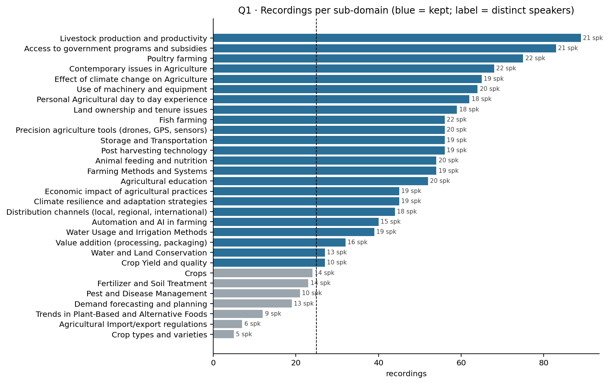
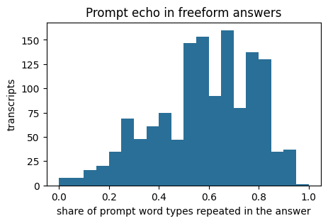
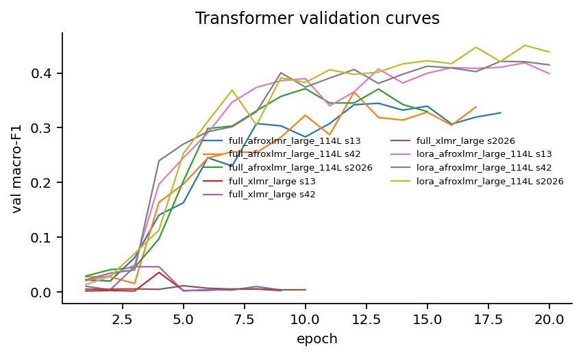
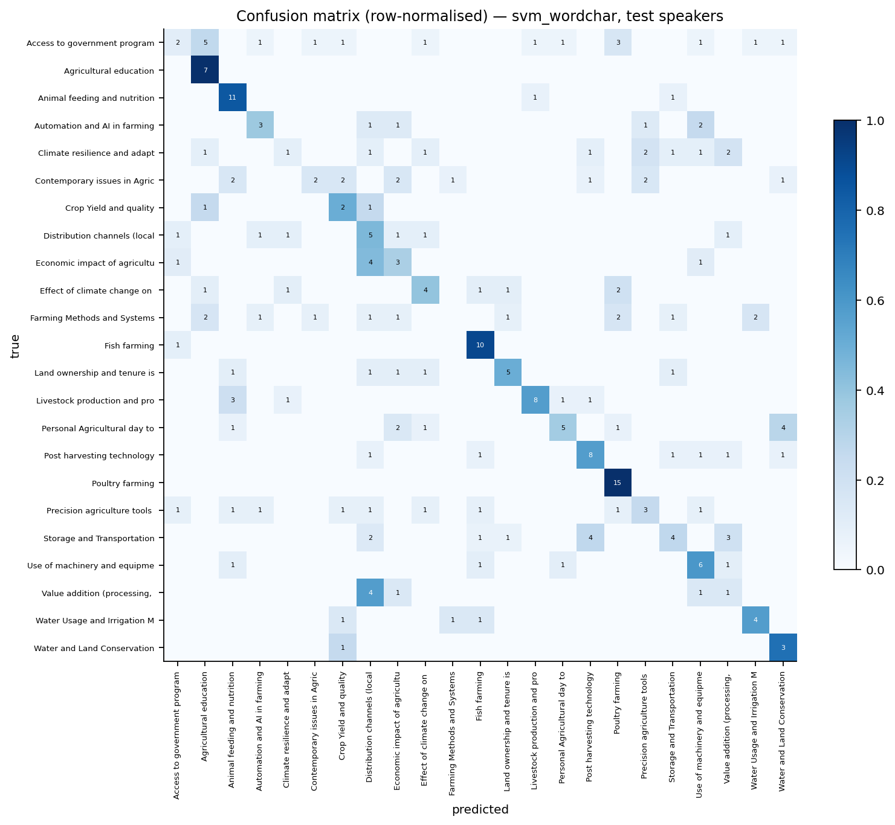
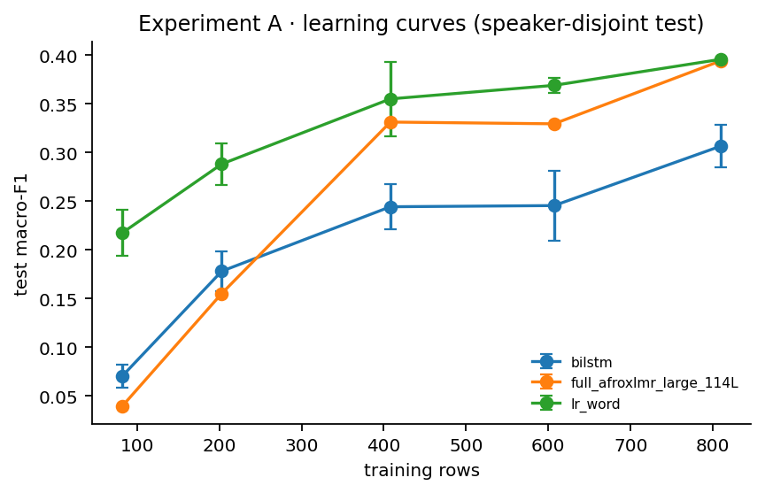
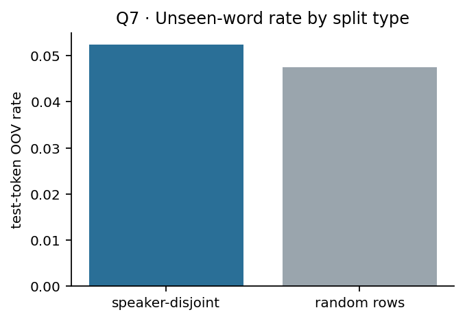
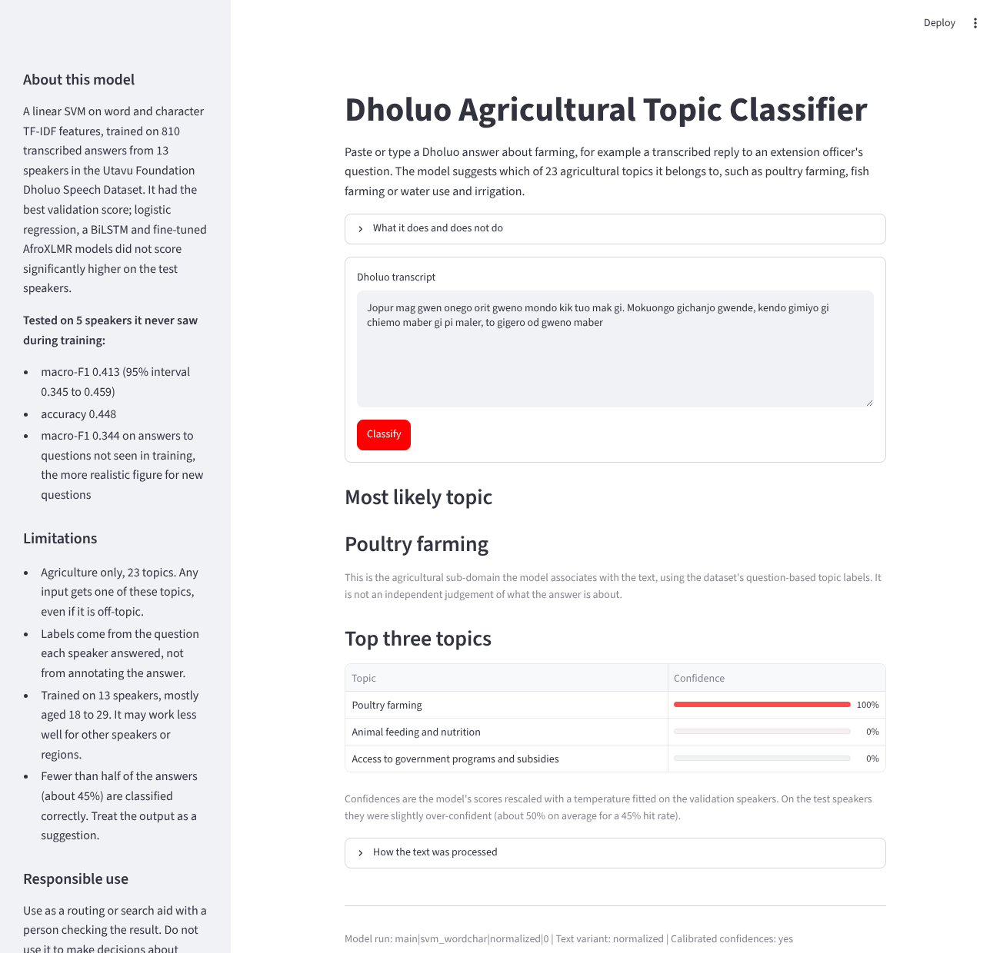

**Project resources**

| Resource | Link |
|---|---|
| Live application | <https://machine-learning-technique1-summative-6lhzhgn9tuwa7wuhtrdjcf.streamlit.app/> |
| GitHub repository | <https://github.com/OgayoTK1/machine-learning-technique1-summative> |
| Demonstration video | <https://www.youtube.com/watch?v=Fs2sN2lSI-w> |
| Executed notebook | `notebooks/dholuo_topic_classification_final.ipynb` in the repository |

# Abstract

Dholuo is a Western Nilotic language spoken by millions of people in western Kenya and northern Tanzania, yet it has few labelled resources for natural language processing. This report studies whether transcribed, spontaneously spoken Dholuo answers about agriculture can be assigned to one of 23 agricultural sub-domains when every test speaker is unseen during training. Using the Utavu Foundation Dholuo Speech Dataset (1,359 approved transcripts from 23 speakers), I audit the data, build a speaker-disjoint split (810 / 188 / 250 transcripts from 13 / 5 / 5 speakers), and compare majority and TF-IDF baselines, a BiLSTM with attention, and the pretrained multilingual encoders AfroXLMR-large-114L and XLM-R-large under full fine-tuning, LoRA and a frozen encoder. Ten controlled experiments examine training-set size, normalisation, class weighting, speaker leakage, dialect, code-switching, fine-tuning strategy, prompt overlap and existing machine-translation tools. A linear SVM on word and character TF-IDF features has the best validation score and is selected; on the unseen test speakers it reaches macro-F1 0.413 (95% interval 0.345 to 0.459) and accuracy 0.448. LoRA-tuned AfroXLMR has the highest mean test macro-F1 (0.416 over three seeds) but is statistically tied with the SVM. African-language pretraining is decisive at fixed architecture (AfroXLMR 0.404 against XLM-R 0.046 under full fine-tuning). The largest effect is prompt overlap: speakers repeat a median 60% of the question's words, the SVM scores 0.501 on answers to questions seen in training but 0.344 on new questions, and removing shared prompts from training lowers logistic regression from 0.396 to 0.311. A translate-to-English pipeline with NLLB-200 performs significantly worse (0.181 zero-shot, 0.318 trained on translations). The selected model, with confidences calibrated on validation speakers (expected calibration error 0.10 on test), is deployed as a public Streamlit application. I discuss the limits imposed by 23 speakers, question-derived labels and prompt overlap.

# 1. Introduction and background

Most NLP research and tooling concentrates on a small number of high-resource languages, leaving the majority of the world's languages with little data or software support (Joshi et al., 2020). African languages are heavily affected, although community efforts have produced multilingual encoders adapted to African languages, such as AfriBERTa (Ogueji et al., 2021), AfroXLMR (Alabi et al., 2022) and SERENGETI (Adebara et al., 2023), and evaluation datasets such as MasakhaNEWS (Adelani et al., 2023) and SIB-200 (Adelani et al., 2024).

Dholuo (ISO 639-3 `luo`) belongs to the Western Nilotic branch and is spoken mainly around Lake Victoria. Its use is concentrated in informal settings, while English and Kiswahili dominate formal domains such as education, governance and commerce (Mbogho et al., 2025). For agricultural information services this creates a gap: farmers who are most comfortable speaking Dholuo are the least served by text-based systems in English or Kiswahili.

The Utavu Foundation Dholuo Speech Dataset, released in 2026 by the Utavu Foundation and CLEAR Global and stewarded by the Maseno Centre for Applied AI, contains spontaneous spoken answers to agricultural questions with editor-approved transcripts, speaker metadata and topic labels (Utavu Foundation and CLEAR Global, 2026). It makes it possible, for the first time to my knowledge, to study fine-grained agricultural topic classification of spontaneous Dholuo under speaker-independent conditions.

# 2. Problem definition

**Research question.** How accurately can classical, recurrent and pretrained multilingual models assign transcribed, spontaneously spoken Dholuo agricultural answers to their agricultural sub-domain when every test speaker is unseen during training, and how does that accuracy change with training-set size, text normalisation, dialect, code-switching, fine-tuning strategy, prompt overlap, and compared with existing machine-translation tools?

| Element | Definition |
|---|---|
| Input | The editor-approved Dholuo transcript of one spoken answer (10 to 60 seconds of speech; 16 to 158 words) |
| Output | One of 23 agricultural sub-domains, with a calibrated confidence and a ranking over all 23 |
| Target | The `sub_domain` field of the free-form subset, restricted to classes with at least 25 recordings and 5 speakers |
| Primary metric | Macro-F1 on speaker-disjoint test data |
| Secondary metrics | Accuracy, macro precision and recall, weighted F1, per-class precision/recall/F1, confusion matrix, bootstrap 95% intervals, seed-to-seed variation, expected calibration error |

An important property of the target must be stated at the outset: the label of each recording is the sub-domain of the **question** the speaker was asked, inherited from the prompt. It is not an independent annotation of the **answer**. The task is therefore to predict the question-associated sub-domain of a transcript; it does not establish the objectively correct topic of what was said. Sections 7.5 and 8 show where this distinction matters.

# 3. Objectives and scope

**Objectives.** (1) Audit the dataset and choose a defensible supervised task from the evidence. (2) Build reproducible preprocessing and a leakage-controlled, speaker-disjoint split. (3) Compare floors, classical baselines, a recurrent model and pretrained transformers under one protocol. (4) Run controlled experiments that each answer a stated question. (5) Analyse errors quantitatively and qualitatively. (6) Deploy the selected model in a web application that communicates its limits.

**In scope.** Text classification of transcripts from the free-form subset; Dholuo only; agriculture only; deployment of the selected model as a public web application.

**Out of scope.** Speech recognition (the application expects text), translation, agricultural advice, detection of out-of-domain or non-Dholuo input, and redistribution of the dataset.

The choice of topic classification over automatic speech recognition was made from the audit (notebook section 4): every free-form transcript carries a label; the classical-recurrent-pretrained comparison applies directly, which it does not for ASR; and every experiment fits a single-GPU budget with three seeds, whereas ASR fine-tuning would allow at most one seed per configuration. ASR on the same speaker split is proposed as future work.

# 4. Background and existing approaches

**Pretrained encoders for African languages.** XLM-R (Conneau et al., 2020) is a Transformer encoder pretrained on CommonCrawl text in 100 languages; Luo is not among them. AfroXLMR (Alabi et al., 2022) continues masked-language-model training of XLM-R on African languages (multilingual adaptive fine-tuning). The checkpoint used here, `Davlan/afro-xlmr-large-114L`, lists Luo among its pretraining languages on its model card. I make no assumption about how much Dholuo text it saw.

**Topic classification for African languages.** MasakhaNEWS (Adelani et al., 2023) provides news topic classification in 16 languages that do not include Luo. SIB-200 (Adelani et al., 2024) annotates about 1,000 Flores-200 sentences with 7 broad topics (science/technology, travel, politics, sports, health, entertainment, geography) and extends the labels to the 200+ Flores languages, which include Luo; its texts are written translations of English Wikipedia sentences rather than spontaneous speech, and none of its topics concerns agriculture.

**Machine translation.** NLLB-200 (NLLB Team, 2022) is an open translation model covering Luo (`luo_Latn`), and Google Translate added Dholuo in its 2024 expansion to 110 new languages (Google, 2024). A natural alternative to a Dholuo classifier is therefore to translate into English and classify with English tools such as entailment-based zero-shot classification (Yin et al., 2019) using BART-large fine-tuned on MultiNLI (Lewis et al., 2020; Williams et al., 2018).

**Parameter-efficient fine-tuning and calibration.** LoRA (Hu et al., 2022) freezes a pretrained model and trains low-rank updates to selected weight matrices, reducing the number of trained parameters by orders of magnitude. Temperature scaling (Guo et al., 2017) rescales a classifier's scores with one parameter fitted on held-out data so that confidences match observed accuracy.

**Gap.** To my knowledge no public dataset or model addresses fine-grained agricultural topic classification of spontaneous Dholuo evaluated on unseen speakers. Experiment I (section 7.6) tests the strongest existing-tools route empirically rather than relying on this literature search alone.

# 5. Dataset description and data-quality analysis

## 5.1 Source and access

| Property | Value |
|---|---|
| Dataset | Utavu Foundation Dholuo Speech Dataset, Hugging Face `MCAA1-MSU/twb_luo_ke` |
| Revision used | `5cbcd61d844e29e80e5e574fa14a7c54603052c3` |
| Creators | Utavu Foundation and CLEAR Global (TWB Voice platform); steward: Maseno Centre for Applied AI |
| Licence | Nwulite Obodo Open Data License (NOODL-1.0); gated access |
| Recording period | 16 May to 16 June 2026 (dataset card) |
| Files used | `utavu-freeform_prompts_data/Files/transcripts.csv` and `meta.csv`; the image-prompt equivalents for statistics only |

The repository layout (`Files/transcripts.csv`, `Files/meta.csv`) differs from the paths given in the dataset README (`files/freeform_transcripts.csv`, `files/freeform_metadata.csv`); the notebook locates the files from the repository listing.

## 5.2 Record-level quality

| Check | Free-form subset | Image-prompt subset |
|---|---|---|
| Rows | 1,359 | 1,029 |
| Speakers | 23 | 21 (all also in free-form) |
| Unique prompts | 1,019 (340 answered by more than one speaker) | 658 |
| Audio | 10.64 h; 10.1 to 59.8 s per clip | 8.93 h |
| Missing values, empty transcripts, duplicate files or transcripts | none | none |
| Transcription status | all approved | 1 rejected |
| Editor-corrected transcripts | 586 (43%) | 161 (16%) |
| Words per transcript | mean 59.9, range 16 to 158 | mean 64.3, range 17 to 172 |
| Speech-rate outliers (< 0.5 or > 4.5 words/s) | none (median 2.14 words/s) | none |

## 5.3 Text-level quality

The text contains inconsistencies that matter for preprocessing: code-switching markers appear as `[cs]` (771 occurrences), `[CS]` and `[[cs]`; pause markers as `[pause]` and `[Pause]`; one transcript has an unclosed tag and one an odd number of `[cs]` markers; 144 transcripts lack a space after punctuation; 20 use curly apostrophes; and capitalisation is irregular. 225 free-form transcripts (17%) contain at least one code-switched span into English or Kiswahili.

## 5.4 Speakers and dialect

| Attribute | Distribution (23 speakers) |
|---|---|
| Gender | 12 male, 11 female |
| Age | 18 to 29: 18; 30 to 39: 4; 50 to 59: 1 |
| Dialect (project survey) | Nyanduat (north): 14; Milambo (south): 9 |
| Education | Bachelor's 10; college diploma/certificate 9; secondary 3; postgraduate 1 |

The two dialect fields in the metadata disagree for 14 of the 23 speakers; for example, nine speakers who chose "Milambo" on the registration form report Nyanduat as their primary variety in the survey. Following the dataset card, I use the survey field, and I treat dialect results with caution.

## 5.5 Label validity

Of 30 sub-domains, 7 have fewer than 25 recordings (5 to 24) and are excluded, leaving **23 sub-domains and 1,248 transcripts** (111 excluded). Among kept classes the largest-to-smallest ratio is 3.3 (89 to 27 recordings), every class has at least 10 speakers, and no single speaker contributes more than 25% of a class. Every prompt maps to exactly one sub-domain. Figure 1 shows the class sizes.

## 5.6 Leakage risks and prompt echo

Three features could inflate scores: all recordings come from 23 people; the prompt text determines the label (it is never used as input); and prompts recur across speakers while answers repeat their prompts. I measured the last effect directly: **the median answer contains 60% of its prompt's word types, 33.5% of answers open by restating the prompt, and 14.9% contain at least 80% of the prompt's words** (figure 2).

# 6. Methodology and experimental design

## 6.1 Preprocessing and feature engineering

Cleaning steps (empty text, rejected transcription, duplicate file, duplicate speaker-transcript pair) removed no rows, consistent with the audit; only the 111 recordings in ineligible classes were dropped. Three text variants were built:

* `minimal`: Unicode NFC and whitespace normalisation;
* `normalized`: additionally straight apostrophes, lower case, consistent spacing around punctuation, and one canonical token each for code-switching (`<cs>`), pauses (`<pause>`) and unclear speech (`<unclear>`) whatever spelling the transcriber used;
* `normalized_notags`: as `normalized` with markers removed and code-switched words kept.

Stop-word removal, stemming, spelling correction, removal of apostrophes inside words (such as *ng'ado*) and removal of English or Kiswahili words were deliberately avoided because they discard linguistic information. The preprocessing was written once, executed in the notebook and exported with the model; the application uses an identical implementation whose parity with the notebook is tested automatically.

Features: TF-IDF over word n-grams (the word pattern keeps apostrophes and markers) or character 2-5-grams within word boundaries, with sublinear term frequency and case preserved (so that the variants genuinely differ); learned word embeddings for the BiLSTM; SentencePiece subwords for the transformers.

## 6.2 Speaker-disjoint split

With 23 speakers a random choice of test speakers can easily omit classes or a dialect. A seeded search over 20,000 candidate speaker groupings (seed 42) selected test speakers, then validation speakers, minimising the Jensen-Shannon divergence between each split's class distribution and the overall distribution, with penalties for missing classes, deviation from 20% (test) and 15% (validation) of rows, and absence of either dialect. Only labels and metadata were used.

| Split | Transcripts | Speakers | Nyanduat / Milambo speakers | Female speakers | Code-switched | Mean words |
|---|---|---|---|---|---|---|
| Train | 810 | 13 | 10 / 3 | 6 | 113 | 52.0 |
| Validation | 188 | 5 | 2 / 3 | 2 | 38 | 79.6 |
| Test | 250 | 5 | 2 / 3 | 3 | 52 | 70.9 |

All 23 classes appear in every split. There is no speaker overlap and no exact or near-duplicate transcript across splits (character TF-IDF cosine above 0.9: none). By design, 101 of the 250 test answers respond to a prompt also answered by a training speaker; this is studied in Experiment H. Only 3 of the 13 training speakers speak Milambo.

## 6.3 Models

| Model | Architecture and training |
|---|---|
| Majority, stratified | Constant most frequent class; random by class prior |
| TF-IDF + LR (word, char) | Multinomial logistic regression, L2, class-weighted; C and n-gram settings by grid search on validation |
| TF-IDF + SVM (selected) | Linear SVM (one-vs-rest) on word 1-2-gram and character 2-5-gram TF-IDF features combined; class-weighted; C by grid search on validation (C = 0.1); margins converted to probabilities with a softmax temperature fitted on validation (T = 0.080) |
| BiLSTM + attention | 128-d embeddings learned from scratch (training vocabulary, frequency at least 2), one bidirectional LSTM layer (2 x 128), additive attention pooling, dropout 0.4, linear output; AdamW (lr 2e-3), class-weighted cross-entropy, early stopping on validation macro-F1 (patience 6, up to 40 epochs); 563,095 parameters |
| AfroXLMR full fine-tuning | `Davlan/afro-xlmr-large-114L`, 24 layers, hidden size 1024, 16 heads, 250,002-piece vocabulary; all weights except the input-embedding matrix updated (303.9M of 559.9M parameters); AdamW lr 2e-5, linear warm-up (10%) and decay, effective batch 16, fp16, gradient checkpointing, up to 20 epochs with patience 5 |
| AfroXLMR LoRA | Encoder frozen; rank-16 adapters (alpha 32, dropout 0.1) on attention query and value, plus classification head (2.65M trainable parameters); lr 2e-4 |
| AfroXLMR frozen | Mean of final hidden states, logistic-regression head (23,575 parameters) |
| XLM-R full fine-tuning | `FacebookAI/xlm-roberta-large`, identical settings to AfroXLMR full fine-tuning |

Freezing the input embeddings and enabling gradient checkpointing kept peak GPU memory at 7.2 GB on a 15.6 GB Tesla T4, and limits drift of rare-token embeddings on 810 examples. Both checkpoints use the same tokenizer and segment Dholuo identically (1.7 subwords per word; 44.8% of words are a single piece), so differences between them reflect pretraining rather than tokenization. Seeds 13, 42 and 2026 were used for every neural model. The complete hyperparameter table is in Appendix B.

## 6.4 Selection protocol and statistics

Test scores were recorded for every run but never used for any choice. Hyperparameters, the text variant and the final model were chosen on validation macro-F1. The final-model rule was fixed in advance: rank models by mean validation macro-F1; among models within one standard deviation of the best, choose the least complex (majority < logistic regression < SVM < BiLSTM < frozen encoder < LoRA < full fine-tuning). Confidence intervals use 2,000 bootstrap resamples of test rows and, more conservatively, of test speakers; model comparisons use a paired bootstrap on the same resamples; subgroup error rates use Wilson intervals (Wilson, 1927; Efron and Tibshirani, 1993).

## 6.5 Experiments

| ID | Question | Design |
|---|---|---|
| A | How quickly do models improve with more data? | Per-class subsampling of training rows at 10, 25, 50, 75, 100% |
| B | Does normalisation help? | Three text variants for TF-IDF LR and BiLSTM |
| C | Does model sophistication pay off? | All models on one split, paired bootstrap |
| D | Does dialect matter? | Subgroups on test and on speaker-grouped out-of-fold predictions |
| E | Does code-switching cause failures? | Same subgroup design |
| F | How much does speaker leakage inflate scores? | 5-fold speaker-grouped vs random-row CV on development speakers, three repetitions |
| G | Which fine-tuning strategy is best for the compute? | Frozen, LoRA, full fine-tuning on AfroXLMR |
| H | Is the model reading the answer or recognising the question? | Seen vs unseen prompts; retraining without test prompts |
| I | Do existing tools already solve the task? | NLLB-200 translation, then zero-shot BART-MNLI or TF-IDF LR |
| Ablation | Does class weighting help? | Weighted vs unweighted loss, C re-tuned for each |

# 7. Results

All numbers below are taken from the executed notebook; Appendix A maps each table to its notebook section. The full run took 166.2 minutes on a Tesla T4 and logged 91 model runs.

## 7.1 Model comparison and selection (Experiment C)

| Model | Runs | Val macro-F1 | Test macro-F1 | Test acc. | Test weighted F1 | 95% CI, rows | 95% CI, speakers |
|---|---|---|---|---|---|---|---|
| **TF-IDF + SVM (word + char), selected** | 1 | 0.432 | **0.413** | 0.448 | 0.414 | 0.345 to 0.459 | 0.367 to 0.425 |
| LoRA AfroXLMR | 3 | 0.430 ± 0.018 | 0.416 ± 0.005 | 0.436 | 0.420 | 0.352 to 0.470 | 0.394 to 0.454 |
| TF-IDF + LR (word) | 1 | 0.427 | 0.396 | 0.424 | 0.409 | 0.329 to 0.442 | 0.375 to 0.425 |
| TF-IDF + LR (char) | 1 | 0.423 | 0.371 | 0.408 | 0.373 | 0.306 to 0.414 | 0.329 to 0.396 |
| AfroXLMR full | 3 | 0.360 ± 0.014 | 0.404 ± 0.020 | 0.431 | 0.417 | 0.362 to 0.472 | 0.376 to 0.453 |
| BiLSTM + attention | 3 | 0.337 ± 0.027 | 0.307 ± 0.022 | 0.339 | 0.318 | 0.234 to 0.331 | 0.258 to 0.294 |
| AfroXLMR frozen | 1 | 0.290 | 0.227 | 0.256 | 0.239 | 0.177 to 0.266 | 0.178 to 0.267 |
| XLM-R full | 3 | 0.031 ± 0.018 | 0.046 ± 0.042 | 0.089 | 0.055 | 0.055 to 0.119 | 0.067 to 0.103 |
| Stratified random | 1 | 0.039 | 0.035 | 0.048 | 0.043 | 0.017 to 0.055 | 0.023 to 0.045 |
| Majority class | 1 | 0.005 | 0.005 | 0.056 | 0.006 | 0.002 to 0.007 | 0.003 to 0.006 |

Means and standard deviations are over seeds; the interval columns describe each model's best-validation run (the run that would be deployed), which is why the interval for multi-seed models need not centre on the mean.

The SVM has the best validation score (0.432). Because it is deterministic, it has a single run and a standard deviation of zero, so the one-standard-deviation band around it contains no other model and the rule selects the **SVM**. The runners-up are very close: LoRA AfroXLMR 0.430 ± 0.018, word-level logistic regression 0.427 and character-level logistic regression 0.423. Had the band been taken from the seed-to-seed spread of the stochastic runner-up (0.018), it would also have included word-level logistic regression, and the rule would have chosen that simpler model; the two are statistically tied on test (below), so the practical consequence of this detail of the rule is small. Paired bootstrap differences on the test set (selected SVM minus other):

| Comparison | Difference | 95% interval | Conclusion |
|---|---|---|---|
| vs LoRA AfroXLMR (best-val run) | -0.007 | -0.074 to +0.056 | tie |
| vs TF-IDF + LR (word) | +0.017 | -0.031 to +0.061 | tie |
| vs TF-IDF + LR (char) | +0.042 | +0.006 to +0.076 | SVM better |
| vs AfroXLMR full | -0.014 | -0.073 to +0.041 | tie |
| vs BiLSTM | +0.124 | +0.055 to +0.187 | SVM better |
| vs AfroXLMR frozen | +0.186 | +0.120 to +0.243 | SVM better |
| vs XLM-R full | +0.323 | +0.255 to +0.379 | SVM better |

On 810 training examples the strongest pretrained model matches but does not beat a well-tuned linear model, which is smaller, faster and easier to deploy and explain. African-language pretraining is decisive at fixed architecture and tokenizer: AfroXLMR full fine-tuning gave 0.394, 0.391 and 0.427 across seeds, while XLM-R gave 0.041, 0.090 and 0.007; its validation macro-F1 stayed below 0.05 in every epoch, so it never learned the task.

## 7.2 The selected model on the test set

On the five unseen test speakers the selected SVM reaches macro-F1 0.413, macro precision 0.420, macro recall 0.467, accuracy 0.448 and weighted F1 0.414 (validation: macro-F1 0.432, accuracy 0.489). The small validation-test gap suggests the selection did not overfit the validation speakers.

| Best classes | F1 | Worst classes | F1 |
|---|---|---|---|
| Poultry farming | 0.769 | Farming methods and systems (12 test examples) | 0.000 |
| Fish farming | 0.741 | Value addition (processing, packaging) | 0.125 |
| Livestock production | 0.667 | Climate resilience and adaptation | 0.133 |
| Animal feeding and nutrition | 0.667 | Access to government programmes | 0.160 |
| Agricultural education | 0.583 | Contemporary issues in agriculture | 0.235 |

Classes with distinctive vocabulary (*rech*, fish; *gweno*, chicken) are easy; broad or overlapping classes are hard. Access to government programmes is often predicted as agricultural education, which as a result has perfect recall but precision 0.41. The full per-class table is in `reports/REPORT_TABLES.md` and notebook section 13.

**Calibration.** The SVM's margins are converted to probabilities with a softmax temperature (T = 0.080) fitted on the validation speakers. On the test speakers the mean top-class confidence is 0.504 against an accuracy of 0.448, an expected calibration error of 0.102 (10 bins): slightly over-confident but usable. Temperature scaling does not change the predicted class.

## 7.3 Data size, normalisation and class weighting (Experiments A, B, ablation)

| Training rows | 82 | 203 | 408 | 607 | 810 |
|---|---|---|---|---|---|
| TF-IDF + LR | 0.217 | 0.288 | 0.355 | 0.369 | 0.396 |
| BiLSTM | 0.070 | 0.178 | 0.244 | 0.245 | 0.307 |
| AfroXLMR full (1 seed) | 0.039 | 0.155 | 0.331 | 0.329 | 0.394 |

Test macro-F1. All three models are still improving at full size. Logistic regression is the most data-efficient (last step +0.027); the BiLSTM gains +0.061 in the last step; the transformer is ineffective below about 200 examples but has the largest final step (+0.065), suggesting it would pull ahead with more data. The transformer curve uses one seed and flattens between 408 and 607 rows, so it should be read as indicative.

Normalisation has no material effect: the three text variants give test macro-F1 0.391 to 0.396 for logistic regression and 0.307 to 0.320 for the BiLSTM, spreads smaller than the BiLSTM's seed-to-seed variation (about 0.02). `normalized` was selected on validation (0.427 vs 0.424 and 0.423).

Class weighting helps modestly and consistently: logistic regression 0.381 to 0.396 macro-F1 and 0.400 to 0.424 macro recall; BiLSTM 0.297 to 0.307 (within seed noise). With a class ratio of only 3.3 a large effect was not expected.

## 7.4 Speaker leakage, dialect and code-switching (Experiments F, D, E)

| Cross-validation on development speakers | Random rows | Speaker-grouped | Inflation |
|---|---|---|---|
| TF-IDF + LR | 0.404 | 0.368 | +0.036 |
| BiLSTM | 0.280 | 0.259 | +0.020 |

A random split overstates performance, modestly. Consistent with this, unseen-word rates on test tokens are 5.2% under the speaker split and 4.8% under a random split (figure 6): speakers share a common agricultural vocabulary.

**Dialect.** On speaker-grouped out-of-fold predictions for 18 development speakers, logistic regression scores 0.373 on Milambo and 0.372 on Nyanduat speakers (BiLSTM 0.287 and 0.285). On the official test set the dialect intervals overlap for every model (selected SVM: Milambo 0.412, Nyanduat 0.395). Per-speaker accuracy ranges from 0.28 to 0.49, far wider than any dialect difference. With 9 Milambo speakers in total, a small dialect effect cannot be ruled out.

**Code-switching.** On development speakers, logistic regression scores 0.367 on Dholuo-only and 0.355 on code-switched transcripts, the BiLSTM 0.279 and 0.302; on test the SVM scores 0.394 and 0.450. All intervals overlap. Code-switching rates are similar by dialect (17.5% Milambo, 15.6% Nyanduat) but vary between speakers. Code-switched words such as *robot*, *drone* and *store* are themselves strong topic cues (notebook section 7, Q8).

## 7.5 Prompt overlap (Experiment H)

| Model | Seen prompt (n = 101) | Unseen prompt (n = 149) |
|---|---|---|
| TF-IDF + SVM, selected | 0.501 | 0.344 |
| TF-IDF + LR (word) | 0.421 | 0.361 |
| TF-IDF + LR (char) | 0.491 | 0.292 |
| AfroXLMR full | 0.507 | 0.373 |
| LoRA AfroXLMR | 0.360 | 0.416 |
| BiLSTM | 0.378 | 0.234 |

| Retraining without the 101 training rows whose prompts occur in test | Speaker-disjoint | Speaker + prompt disjoint |
|---|---|---|
| TF-IDF + LR (810 to 709 rows) | 0.396 | 0.311 |
| BiLSTM | 0.307 | 0.274 |

Almost every model performs better on answers to prompts seen in training, and removing shared prompts costs logistic regression 0.085 macro-F1. Character n-grams, which can match long stretches of a question verbatim, show the largest gap. LoRA AfroXLMR is the exception: it scores lower on seen than on unseen prompts (0.360 against 0.416, intervals overlapping), which is consistent with the adapter-tuned model relying less on surface wording, and it is the best model on unseen prompts. This is the largest effect in the project: part of every TF-IDF headline score comes from recognising question wording, and **the realistic estimate for the deployed model on new questions is about 0.34 macro-F1** (0.311 for logistic regression retrained without shared prompts). The model card and the application report the unseen-prompt figure.

## 7.6 Existing tools (Experiment I)

| System | Uses Dholuo training data | Val macro-F1 | Test macro-F1 (95% CI) | Test acc. |
|---|---|---|---|---|
| NLLB-200 to English + BART-MNLI zero-shot | no | 0.244 | 0.181 (0.133 to 0.219) | 0.224 |
| NLLB-200 to English + TF-IDF LR trained on translations | yes | 0.423 | 0.318 (0.260 to 0.363) | 0.364 |
| TF-IDF + LR on Dholuo | yes | 0.427 | 0.396 (0.329 to 0.442) | 0.424 |
| TF-IDF + SVM on Dholuo (selected) | yes | 0.432 | 0.413 (0.345 to 0.459) | 0.448 |

All 1,248 transcripts were translated (in chunks of up to 40 words, beam size 2) in 243 seconds. The selected Dholuo model beats both routes significantly (paired differences +0.232, interval +0.161 to +0.297; and +0.095, interval +0.035 to +0.150). Translations read fluently but lose meaning: in the qualitative sample an answer about poultry farmers taking farm loans (*hola*) comes out as asking for "a farm fee" to grow "the pig business", and cattle fodder (*lumb dhok*) becomes "the cattle's cattle". Existing translation tools therefore do not solve this task.

## 7.7 Fine-tuning strategy (Experiment G)

| Strategy (AfroXLMR) | Trainable parameters | Test macro-F1 | Time per run | Peak GPU memory |
|---|---|---|---|---|
| Frozen encoder + LR | 23,575 | 0.227 | 59 s | n/a |
| LoRA r = 16 | 2,646,039 | 0.416 ± 0.005 | 346 s | 4.5 GB |
| Full fine-tuning | 303,911,959 | 0.404 ± 0.020 | 577 s | 7.2 GB |

LoRA gives the best and the most stable result (seeds 0.417, 0.410, 0.420) with about 60% of the time and memory of full fine-tuning, and it is also the best transformer on validation (0.430 against 0.360). A likely reason is that training 2.6M rather than 304M parameters leaves less room to overfit 810 examples. The frozen general-purpose representation is not sufficient on its own.

# 8. Error analysis and discussion

## 8.1 Quantitative error analysis

The selected model misclassifies 138 of 250 test answers (55.2%). Each test answer was tagged with objective flags defined before inspecting errors:

| Flag | Rows | Error rate with flag | Error rate without | Relative risk |
|---|---|---|---|---|
| Prompt unseen in training | 149 | 0.624 (0.54 to 0.70) | 0.446 (0.35 to 0.54) | 1.40 |
| Gold class has low training support | 61 | 0.639 (0.51 to 0.75) | 0.524 (0.45 to 0.59) | 1.22 |
| Long answer (at least training Q3 length) | 142 | 0.556 | 0.546 | 1.02 |
| Code-switched | 52 | 0.538 | 0.556 | 0.97 |
| Milambo speaker | 177 | 0.542 | 0.575 | 0.94 |
| Female speaker | 116 | 0.534 | 0.567 | 0.94 |
| Editor-corrected transcript | 115 | 0.522 | 0.578 | 0.90 |
| High unseen-word rate | 123 | 0.520 | 0.583 | 0.89 |
| Short answer (at most training Q1 length) | 21 | 0.429 | 0.563 | 0.76 |
| Answer barely echoes its prompt (< 30% of prompt words) | 9 | 0.333 | 0.560 | 0.60 |

Answers to unseen prompts are the only group whose error-rate intervals do not overlap with the rest, the same effect as Experiment H; rare classes raise the error rate less clearly. Answer length, code-switching, dialect, gender, editorial correction and unseen words make no material difference; the short and low-echo groups are too small for conclusions.

Confusions follow meaning. The most frequent confusion pairs (4 to 5 errors each) are access to government programmes with agricultural education, distribution channels with value addition and with economic impact, post-harvest technology with storage and transportation, and animal feeding with livestock production. Across all 253 class pairs, lexical similarity between classes (cosine similarity of training TF-IDF centroids) correlates with confusion rate (Spearman rho = 0.25, p = 7.2e-5). 74 of 250 test answers (29.6%) are misclassified by every model in the study, which points to properties of the data (overlapping topic definitions, answers that do not match their question's label) rather than to any one model. Per-speaker error rates are similar across the five test speakers (0.49 to 0.59).

## 8.2 Qualitative analysis

Twelve test examples were drawn at random with a fixed seed from six groups (confident and correct, unsure and correct, confident and wrong, unsure and wrong, code-switched, short). The readings below are based on the question asked, the transcript, the NLLB English translation and word-occlusion analysis, and should be confirmed by a Dholuo speaker before being quoted as linguistic fact.

* **Correct predictions are driven by topic words.** Both poultry answers rest on *gweno* / *gwen* (chicken), the fish-farming answers on *rech* (fish), and a short irrigation answer on *olo pii* (draw water) and *soko* (well). A personal-experience answer is recognised through first-person verb forms (*anyalo* "I can", *aseyudo* "I have found", *abiro* "I will"), a sensible cue that is not a topic word at all.
* **Neighbouring topics overlap.** An answer about keeping livestock feed in sacks (*gunia*) so that it does not spoil is labelled storage and transportation but predicted post-harvest technology (storage second). An answer about what to do when cut cattle fodder starts to spoil is labelled animal feeding but predicted storage. Feeding, preserving and storing are stages of one chain, and these answers mention several of them.
* **The label follows the question, the content something else.** A question about why poultry farmers should take farm loans (*hola*) is labelled access to government programmes, but the answer talks almost entirely about chickens, and the model predicts poultry farming with 0.99 confidence, the most confident error in the sample. A question about protecting crops against the dry season (*oro*) and pests carries the same label, but the answer describes farming practice, and the model's top three (climate change, personal experience, crop yield) are arguably closer to what was said.

The confident error shows a specific weakness of a linear bag-of-words model: one strong topic word can outweigh everything else in the answer.

## 8.3 Discussion

Three conclusions follow. First, in this data regime a well-tuned linear model is a strong, honest choice: pretrained encoders tie with it on test and need minutes of GPU time per run instead of seconds on a CPU. Second, African-language pretraining is what makes the transformers viable at all; the same architecture without it fails. Third, and most important for anyone building on this dataset, evaluation must control for prompt overlap as well as speakers, because question echo inflates TF-IDF scores by roughly 0.03 to 0.16 macro-F1 (section 7.5). LoRA AfroXLMR's stability on unseen prompts suggests that, once evaluation is restricted to genuinely new questions, the pretrained model is the more promising route; the error analysis indicates that further gains depend as much on the labels (answer-level annotation, merged or redefined adjacent sub-domains) as on the model.

# 9. Web application and deployment

**Architecture.** The application separates the interface from inference. `src/preprocessing.py` reproduces the training normalisation exactly (verified by a test that executes the notebook's preprocessing source on the same inputs). `src/prediction.py` loads `label_map.json` and `model.joblib` from `models/final/` (or `DHOLUO_MODEL_DIR`), checks that the model kind, pipeline structure and label count match, normalises input with the text variant recorded at training time, computes the SVM's decision scores, applies the validation-fitted temperature and a softmax, and returns a ranking over all 23 sub-domains. `app.py` is a thin Streamlit layer. The deployed model is the evaluated run `main|svm_wordchar|normalized|0`, exported by notebook section 17 without modification.

**Behaviour.**

* Accepts a Dholuo transcript; transcription markers such as `[cs]...[cs]`, `[pause]` and `[?]` are handled as in training.
* Shows the most likely sub-domain, described as the dataset's question-associated topic rather than a judgement of what the answer is about, and the top three topics with calibrated confidence percentages.
* Rejects empty, word-less or oversized input with a clear message; warns about inputs shorter than 10 words (training minimum 16), longer than 300 words (training maximum 158), or with fewer than 60% of words known to the model, and states that every input receives one of the 23 topics.
* Reports missing or incompatible model files with instructions instead of failing, and displays the verified evaluation figures (including the unseen-prompt macro-F1 of 0.344), limitations and responsible-use guidance in a sidebar.

**Deployment.** The application is deployed on Streamlit Community Cloud from the public GitHub repository (branch `main`, main file `app.py`) at <https://machine-learning-technique1-summative-6lhzhgn9tuwa7wuhtrdjcf.streamlit.app/>. Streamlit installs the pinned `requirements.txt` (scikit-learn 1.6.1, the version used to pickle the model) and loads `models/final/` at start-up. The first deployment failed with a missing-module error: the platform had created the app with Python 3.14, for which scikit-learn 1.6.1 publishes no pre-built package, so dependency installation failed. Redeploying with Python 3.12 resolved it. I verified that the model file in the repository is byte-identical to the evaluated export and that a clean Python 3.12 installation of `requirements.txt` loads it and reproduces its predictions. The demonstration video (<https://www.youtube.com/watch?v=Fs2sN2lSI-w>) shows the deployed application in use.

**Functional validation with the trained model.** Table below lists inputs run through the application with the real exported model. They are short, hand-written sentences that exercise the interface and its warnings; they are not an accuracy estimate, which comes from the 250-answer test set. Their high confidences reflect that each packs several strong topic words into one sentence.

| Input (abridged) | Expected topic | Prediction and confidence | Warning shown | Outcome |
|---|---|---|---|---|
| *Jopur mag gwen onego orit gweno ... gichanjo gwende ...* | Poultry farming | Poultry farming, 100% | none | correct |
| *Japur nyalo olo pii e puothe ndalo oro ... soko kata kunyo pii* | Water usage and irrigation | Water usage and irrigation, 99% | none | correct |
| *Sirikal okelo chenro mag konyo jopur gi pesa kod kothe* | Government programmes | Access to government programmes, 100% | none | correct |
| *drone konyo jopur ng'eyo chal mar puothe kod [cs]GPS[cs]* | Precision agriculture | Precision agriculture tools, 97% | short input (9 words) | correct; code-switch marker handled |
| *Jopur kano chiemb jamni e gunia ... e ot maler* | Storage (or post-harvest) | Storage and transportation 38%, post-harvest 36% | none | uncertain between neighbouring topics |
| *Ka japur oting'o cham e gari mar chiro ... e gunia ...* | Storage and transportation | Value addition 39% (storage 33% second) | none | wrong, neighbouring topic |
| *Jopur mag gwen onego okwa hola mar pur ...* | Government programmes (farm loans) | Poultry farming, 99.7% | none | confident and wrong: topic word dominates |
| *hello this is english text* | none (off-domain) | Farming methods and systems, 11% | short input; only 20% of words known | warned as designed |
| (empty input) | none | no prediction | "Please enter a Dholuo transcript" | handled |

# 10. Limitations and reliability considerations

* **Question-derived labels.** The model predicts the question-associated sub-domain; some answers drift or span topics (section 8.2).
* **Prompt echo.** Headline TF-IDF scores include a benefit from seen questions; about 0.34 macro-F1 is the realistic estimate for the deployed model on new questions.
* **Small, narrow speaker base.** 23 speakers, 13 in training, 18 of them aged 18 to 29 and one over 40; one transcription team; agriculture only. The test set has 5 speakers, so subgroup estimates are imprecise.
* **Dialect evidence is weak.** 9 Milambo speakers (3 in training) and inconsistent dialect metadata.
* **Moderate accuracy.** About 45% of test answers are correct; 30% of test answers defeat every model.
* **Calibration.** Confidences are fitted on 5 validation speakers and are slightly over-confident on test (ECE 0.10); they have not been checked on real user input.
* **Single-seed transformer learning curve** and a single split; results could shift with a different selection of test speakers.
* **Closed label set.** No out-of-domain detection; non-Dholuo or off-topic text still receives a topic, with a warning.
* **Text only.** The application does not accept audio.
* **Platform dependence.** The model requires scikit-learn 1.6.1 and therefore Python 3.13 or earlier until it is re-exported with a newer library version.

# 11. Ethical considerations and responsible use

Voice recordings are biometric data. The project uses only transcripts and pseudonymous speaker identifiers and never attempts to identify contributors. The dataset is not redistributed; the repository contains code, configuration, split identifiers, result tables and instructions for obtaining the data. The executed notebook displays a few short transcript excerpts for the qualitative analysis, and the published model contains a vocabulary drawn from the transcripts but no transcripts; both remain subject to NOODL-1.0 and the dataset's access conditions. The NOODL-1.0 licence permits open use in developing countries and asks users elsewhere to share benefits with the contributing communities.

The system is suitable only as a low-stakes routing or search aid with a person reviewing the output. It must not be used for decisions about people, such as eligibility for subsidies, credit or programmes. Its training population (mostly young adults) means it may serve older farmers, other regions and other dialect groups less well, and it should not be described as understanding Dholuo in general.

# 12. Conclusion and future improvements

**Completed work.** A data audit and task justification; a speaker-disjoint benchmark of 23 agricultural sub-domains; a comparison of eight model configurations and two floors under one protocol with seeds and bootstrap statistics; ten controlled experiments; quantitative and qualitative error analysis; and a deployed web application serving the selected, calibrated model, with 34 automated tests.

**Answer to the research question.** On unseen speakers, the best models reach about 0.40 to 0.42 macro-F1 on 23 classes (stratified random baseline 0.035; majority class 0.005), with a TF-IDF linear SVM statistically tied with LoRA-tuned AfroXLMR and with word-level logistic regression. Performance grows with data for every model, does not depend measurably on normalisation, dialect or code-switching at this scale, requires African-language pretraining for transformers to work, exceeds what existing translation tools achieve, and falls to about 0.34 for the deployed model on questions not seen in training, where LoRA AfroXLMR (0.416) holds up best.

**Future improvements.**

1. Collect more speakers, especially Milambo speakers and older farmers; all learning curves were still rising.
2. Annotate the topic of each answer, and merge or redefine adjacent sub-domains (value chain stages; automation and precision tools).
3. Use prompt-disjoint as well as speaker-disjoint splits in future data releases.
4. Trial LoRA AfroXLMR in deployment, since it was the most robust model on unseen prompts.
5. Fine-tune ASR on the same speaker split so the application can accept speech.
6. Continue pretraining AfroXLMR on the unlabelled image-prompt transcripts, 61% of whose word types do not occur in the training data.
7. Evaluate on non-agricultural Dholuo and add out-of-domain detection; re-check calibration on real user input.

# References

Adebara, I., Elmadany, A., Abdul-Mageed, M., and Alcoba Inciarte, A. (2023). SERENGETI: Massively Multilingual Language Models for Africa. In *Findings of the Association for Computational Linguistics: ACL 2023*.

Adelani, D. I., Liu, H., Shen, X., Vassilyev, N., Alabi, J. O., Mao, Y., Gao, H., and Lee, E.-S. A. (2024). SIB-200: A Simple, Inclusive, and Big Evaluation Dataset for Topic Classification in 200+ Languages and Dialects. In *Proceedings of EACL 2024*. arXiv:2309.07445.

Adelani, D. I., et al. (2023). MasakhaNEWS: News Topic Classification for African Languages. In *Proceedings of IJCNLP-AACL 2023*. arXiv:2304.09972.

Alabi, J. O., Adelani, D. I., Mosbach, M., and Klakow, D. (2022). Adapting Pre-trained Language Models to African Languages via Multilingual Adaptive Fine-Tuning. In *Proceedings of COLING 2022*.

Bahdanau, D., Cho, K., and Bengio, Y. (2015). Neural Machine Translation by Jointly Learning to Align and Translate. In *Proceedings of ICLR 2015*.

Conneau, A., Khandelwal, K., Goyal, N., Chaudhary, V., Wenzek, G., Guzmán, F., Grave, E., Ott, M., Zettlemoyer, L., and Stoyanov, V. (2020). Unsupervised Cross-lingual Representation Learning at Scale. In *Proceedings of ACL 2020*.

Davlan (n.d.). *afro-xlmr-large-114L* model card. Hugging Face, `Davlan/afro-xlmr-large-114L`.

Efron, B., and Tibshirani, R. J. (1993). *An Introduction to the Bootstrap*. Chapman and Hall/CRC.

Google (2024). 110 new languages are coming to Google Translate. Google blog, June 2024.

Guo, C., Pleiss, G., Sun, Y., and Weinberger, K. Q. (2017). On Calibration of Modern Neural Networks. In *Proceedings of ICML 2017*.

Hochreiter, S., and Schmidhuber, J. (1997). Long Short-Term Memory. *Neural Computation*, 9(8), 1735-1780.

Hu, E. J., Shen, Y., Wallis, P., Allen-Zhu, Z., Li, Y., Wang, S., Wang, L., and Chen, W. (2022). LoRA: Low-Rank Adaptation of Large Language Models. In *Proceedings of ICLR 2022*. arXiv:2106.09685.

Joshi, P., Santy, S., Budhiraja, A., Bali, K., and Choudhury, M. (2020). The State and Fate of Linguistic Diversity and Inclusion in the NLP World. In *Proceedings of ACL 2020*.

Lewis, M., Liu, Y., Goyal, N., Ghazvininejad, M., Mohamed, A., Levy, O., Stoyanov, V., and Zettlemoyer, L. (2020). BART: Denoising Sequence-to-Sequence Pre-training for Natural Language Generation, Translation, and Comprehension. In *Proceedings of ACL 2020*.

Mbogho, A., Awuor, Q., Kipkebut, A., Wanzare, L., and Oloo, V. (2025). Building Low-Resource African Language Corpora: A Case Study of Kidaw'ida, Kalenjin and Dholuo. arXiv:2501.11003.

NLLB Team (2022). No Language Left Behind: Scaling Human-Centered Machine Translation. arXiv:2207.04672.

Ogueji, K., Zhu, Y., and Lin, J. (2021). Small Data? No Problem! Exploring the Viability of Pretrained Multilingual Language Models for Low-resourced Languages. In *Proceedings of the 1st Workshop on Multilingual Representation Learning*.

Paszke, A., et al. (2019). PyTorch: An Imperative Style, High-Performance Deep Learning Library. In *Advances in Neural Information Processing Systems 32*.

Pedregosa, F., et al. (2011). Scikit-learn: Machine Learning in Python. *Journal of Machine Learning Research*, 12, 2825-2830.

Utavu Foundation and CLEAR Global (2026). *Utavu Foundation Dholuo Speech Dataset*. Hugging Face, `MCAA1-MSU/twb_luo_ke`, revision 5cbcd61d. Stewarded by the Maseno Centre for Applied AI. NOODL-1.0.

Williams, A., Nangia, N., and Bowman, S. (2018). A Broad-Coverage Challenge Corpus for Sentence Understanding through Inference. In *Proceedings of NAACL-HLT 2018*.

Wilson, E. B. (1927). Probable Inference, the Law of Succession, and Statistical Inference. *Journal of the American Statistical Association*, 22(158), 209-212.

Wolf, T., et al. (2020). Transformers: State-of-the-Art Natural Language Processing. In *Proceedings of EMNLP 2020: System Demonstrations*.

Yin, W., Hay, J., and Roth, D. (2019). Benchmarking Zero-shot Text Classification: Datasets, Evaluation and Entailment Approach. In *Proceedings of EMNLP-IJCNLP 2019*.

# Appendix A. Traceability of results

| Report section | Source in `notebooks/dholuo_topic_classification_final.ipynb` |
|---|---|
| 5.2 to 5.6 | Section 3 (audit, contributors, label validity, prompt echo), section 5 (cleaning log) |
| 6.2 | Section 6 (split search, split summary, leakage checks) |
| 6.3 | Sections 9, 10, 11, 11.3 (model summary, configurations, tokenizer fertility), 18b |
| 7.1 | Section 12 (Experiment C table and paired bootstrap) |
| 7.2 | Section 13 (per-class report, confusion matrix, calibration line) |
| 7.3 | Sections 9, 14.1, 14.2, 14.3 |
| 7.4 | Sections 14.4, 14.5, and section 7 (Q6, Q7) |
| 7.5 | Section 14.6 |
| 7.6 | Section 14.7 |
| 7.7 | Section 11.2 |
| 8.1 | Section 16 |
| 8.2 | Section 15 and the "Reading the examples" cell |
| 9 | `src/`, `app.py`, `tests/`, `models/final/` in the repository; the live application |

The exported tables are reproduced in `reports/REPORT_TABLES.md` and `reports/results/`; figures in `reports/figures/` were exported by the notebook, except the application screenshot.

# Appendix B. Hyperparameters

| Setting | Value |
|---|---|
| Split seed; training seeds | 42; 13, 42, 2026 |
| Split search | 20,000 candidate speaker groupings; target 20% test, 15% validation |
| Class eligibility | at least 25 recordings and 5 speakers |
| TF-IDF SVM, selected | word 1-2-grams (min_df 1) + char_wb 2-5-grams (min_df 2), sublinear tf, case preserved; LinearSVC C = 0.1 (grid 0.02 to 1.0), class_weight balanced; softmax temperature 0.080 fitted on validation |
| TF-IDF LR (word) | unigrams, min_df 1, sublinear tf, case preserved, C = 1, class_weight balanced, L-BFGS (max_iter 5,000) |
| BiLSTM | embedding 128, hidden 128 per direction, dropout 0.4, AdamW lr 2e-3, weight decay 1e-4, batch 32, max 40 epochs, patience 6, max length 200 tokens, min frequency 2, gradient clip 1.0 |
| Transformers (full) | lr 2e-5, batch 8 x accumulation 2, warm-up 10% then linear decay, weight decay 0.01, max 20 epochs, patience 5, max length 256, fp16, frozen input embeddings, gradient checkpointing |
| LoRA | r 16, alpha 32, dropout 0.1, targets query and value, lr 2e-4 |
| Experiment F | 5-fold cross-validation on development speakers, repeated for each seed |
| Experiment I | NLLB-200 distilled 600M, `luo_Latn` to `eng_Latn`, chunks of at most 40 words, beam 2, max 128 new tokens; BART-large-MNLI, template "This text is about {}." |
| Bootstrap | 2,000 resamples |

The resolved configuration of the reported run is saved in `configs/config_resolved.json`.

# Appendix C. Application validation with the trained model

| Check | Outcome |
|---|---|
| Automated tests (`python -m pytest`) | 34 passed (preprocessing parity with the notebook, prediction, input validation, model-loading errors, calibration script, Streamlit app, and a smoke test against the real exported model) |
| Model integrity | `models/final/model.joblib` in the repository is byte-identical to the evaluated export of run `main\|svm_wordchar\|normalized\|0` |
| Clean-environment install | Python 3.12 with only `requirements.txt` installed loads the model and reproduces its predictions |
| Calibration | Temperature 0.080 fitted on validation in the notebook; test mean confidence 0.504 vs accuracy 0.448, ECE 0.102 |
| App run locally with the exported model | Nine functional cases in section 9 behave as designed, including uncertain and wrong predictions and the input warnings |
| Public deployment | Live on Streamlit Community Cloud with Python 3.12; demonstrated in the video |
